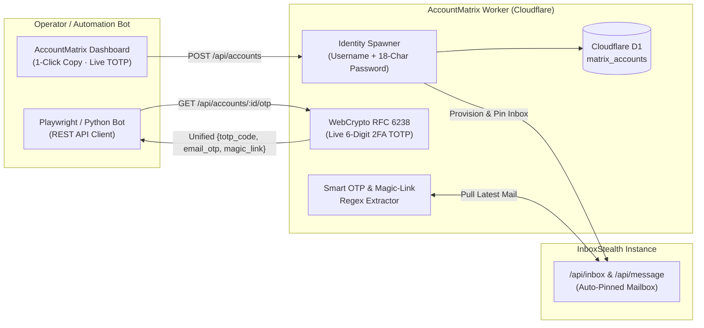

<div align="center">

# ⚡ AccountMatrix

**Edge-native multi-account identity vault, live 2FA TOTP authenticator, trial expiry radar, and [InboxStealth](https://github.com/aplatogg/inboxstealth) OTP bridge on Cloudflare Workers & D1.**

[](https://developers.cloudflare.com/workers/)
[](https://developers.cloudflare.com/d1/)
[](https://datatracker.ietf.org/doc/html/rfc6238)
[](https://github.com/aplatogg/inboxstealth)
[](LICENSE)

[**Architecture**](#-architecture) · [**Key Features**](#-key-features) · [**Quickstart**](#-quickstart) · [**Bot & Automation API**](#-bot--automation-api)

</div>

---

## 🏗️ Architecture

**AccountMatrix** unifies four operational tools into a single tabular edge dashboard and REST API:
1. **1-Click Identity Spawner** — Provisions and auto-pins a fresh disposable mailbox on your [InboxStealth](https://github.com/aplatogg/inboxstealth) instance while generating a natural username and a 18-character cryptographic password.
2. **Built-In Live 2FA TOTP Engine** — Zero-dependency RFC 6238 HMAC-SHA1 TOTP generator running in both WebCrypto (Worker) and browser client.
3. **Live Email OTP & Magic-Link Bridge** — Pulls the latest verification code (`4–8` digits) and activation link directly from the linked InboxStealth mailbox in one click or one API call.
4. **Trial & OPSEC Radar** — Tracks trial expiration countdowns (`Active`, `Trial`, `Cooldown`, `Burned`) alongside browser-profile / proxy OPSEC notes and vaulted API keys.



---

## ✨ Key Features

| Module | Capability |
| :--- | :--- |
| **1-Click Spawn Identity** | Creates an account record, provisions + pins an inbox on your InboxStealth domain, generates a natural human username and a strong 18-char password, and copies the email to your clipboard in one click. |
| **Live 2FA TOTP Column** | Accepts raw Base32 secrets (`JBSWY3DPEHPK3PXP`) or full `otpauth://totp/...` URIs. Renders a live 6-digit code with a 30-second countdown right inside the account row. |
| **1-Click Email OTP Pull** | Click `🔄` on any row (or call `GET /api/accounts/:id/otp`) to fetch the latest email from InboxStealth and automatically extract the verification code (`🔑 849201`) and confirmation link (`🔗 Link`). |
| **OPSEC & Trial Tracking** | Tag accounts with browser profile / proxy notes (`Brave Profile #3 · Proxy SG`), store account-specific API keys and 2FA recovery codes, and track trial expiration windows (`3 / 7 / 14 / 30 / 90 days`). |
| **Zero Dependencies** | Pure ES module running on Cloudflare Workers with native WebCrypto and D1 SQLite. |

---

## 🚀 Quickstart

### 1. Clone & Provision D1

```bash
git clone https://github.com/aplatogg/account-matrix.git
cd account-matrix
npm install

# Create Cloudflare D1 database
npx wrangler d1 create account_matrix_db
```

Copy the returned `database_id` into `wrangler.toml` (or your gitignored `wrangler.local.toml`) and configure your InboxStealth origin:

```toml
[vars]
APP_NAME = "AccountMatrix"
INBOXSTEALTH_ORIGIN = "https://mail.yourdomain.com"
DEFAULT_MAIL_DOMAIN = "yourdomain.com"
```

### 2. Apply Schema & Set Secrets

```bash
# Apply D1 schema
npx wrangler d1 execute account_matrix_db --file=./schema.sql --remote

# Optional: Protect the API/Dashboard with a master key and link your InboxStealth API key
npx wrangler secret put MATRIX_MASTER_KEY
npx wrangler secret put INBOXSTEALTH_API_KEY

# Deploy to Cloudflare Workers
npx wrangler deploy
```

---

## 🤖 Bot & Automation API

Authenticate with `X-Matrix-Key: <MATRIX_MASTER_KEY>` or `Authorization: Bearer <MATRIX_MASTER_KEY>`.

### 1. Spawn a New Account Identity (`POST /api/accounts`)

```bash
curl -s -X POST https://matrix.yourdomain.com/api/accounts \
  -H "X-Matrix-Key: $MATRIX_KEY" \
  -H "Content-Type: application/json" \
  -d '{
    "service": "Steam",
    "tag": "#Alt-01",
    "domain": "yourdomain.com",
    "trial_days": 14,
    "totp_secret": "JBSWY3DPEHPK3PXP",
    "opsec_note": "Brave Profile #3 · Proxy SG"
  }'
```

### 2. Fetch Unified 2FA TOTP + Email OTP (`GET /api/accounts/:id/otp`)

Returns both the live 6-digit 2FA authenticator code **and** the latest email verification OTP / magic link in a single response:

```json
{
  "ok": true,
  "id": "b4c9f8e1-...",
  "address": "rizky.pratama42@yourdomain.com",
  "totp_code": "492810",
  "totp_rem": 19,
  "email_otp": "849201",
  "magic_link": "https://service.example/verify?token=...",
  "message_count": 1,
  "latest_subject": "Your verification code is 849201"
}
```

---

<div align="center">

**[MIT License](LICENSE)** · Crafted by **[@aplatogg](https://github.com/aplatogg)**

</div>
